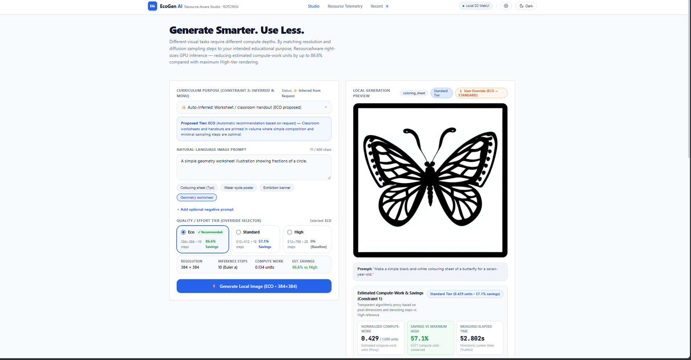
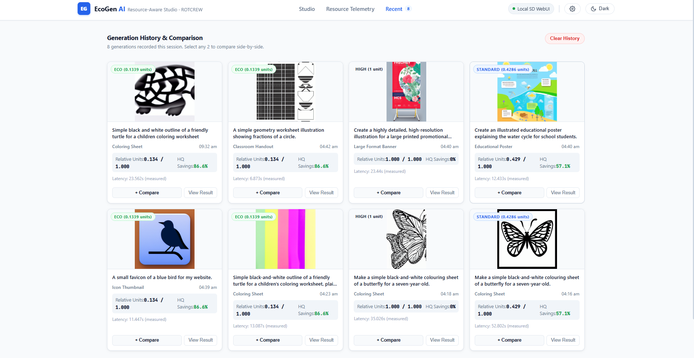

 <div align="center">

# ResourceAware

### Purpose-Aware, Resource-Conscious AI Image Generation

**Generate smarter. Match compute to purpose. Make resource usage transparent.**



<br/>


</div>

---

## Overview

ResourceAware is a resource-conscious AI image generation application that recommends computational effort according to the intended purpose of an image.

Instead of generating every image with the same high-cost settings, ResourceAware analyzes the user's prompt, recommends a suitable quality tier, explains its decision, and allows the user to override the recommendation before generation.

The application connects to a local AUTOMATIC1111 Stable Diffusion WebUI instance and tracks generation history using SQLite.

## The Problem

Educational institutions may need thousands of AI-generated visuals, from simple colouring sheets to detailed classroom posters.

Applying maximum generation settings to every request can waste computational resources on tasks that do not require them. At the same time, users need visibility into the trade-off between image quality, processing time, and estimated computational workload.

## Our Solution

ResourceAware introduces purpose-aware generation through four steps:

1. **Understand the prompt** — classify the intended use with deterministic, rule-based inference.
2. **Recommend a quality tier** — choose Eco, Standard, or High based on the detected purpose.
3. **Explain the recommendation** — show the rationale and generation parameters before execution.
4. **Measure and report** — generate through the local model and display elapsed time alongside transparent resource estimates.

Users retain control over the final quality tier.

## Screenshots

<div align="center">

### Generation Workflow



*Prompt analysis, quality selection, generation, and result preview.*

### Resource Telemetry


*Generation history and resource metrics, based on recorded application data.*

</div>

> Replace these example images with screenshots of the actual application. If a separate telemetry screenshot is available, use it for the second image.

## Quality Tiers

| Tier | Resolution | Sampling Steps | Work Units | Savings vs. High |
|---|---:|---:|---:|---:|
| **Eco** | 384 × 384 | 10 | 1,474,560 | 86.6% |
| **Standard** | 512 × 512 | 18 | 4,718,592 | 57.1% |
| **High** | 512 × 768 | 28 | 11,010,048 | 0% — Reference |

All tiers use batch size 1 and the configured `Euler a` sampler.

### Resource Estimation

ResourceAware calculates a transparent compute-work proxy:

\[
W = \text{width} \times \text{height} \times \text{sampling steps}
\]

\[
\text{Savings (\%)} =
100 \times \left(1-\frac{W_{\text{selected}}}{W_{\text{high}}}\right)
\]

The High tier is the reference configuration.

**Important:** These figures are algorithmic workload estimates, not measured electricity consumption. They do not represent actual energy in joules or kWh. Elapsed generation time is measured separately using a monotonic timer.

## Purpose Inference

| Intended Use | Recommended Tier | Reason |
|---|---|---|
| Colouring sheets and simple worksheets | Eco | Simple visuals generally need less rendering effort |
| Flashcards and basic educational graphics | Eco | Clear, compact visuals are the priority |
| Lesson diagrams and classroom posters | Standard | Balanced detail and resolution |
| Detailed illustrations and large-format concepts | High | More rendering effort may be appropriate |
| Ambiguous prompts | Standard | A balanced default |

Purpose inference uses deterministic pattern matching and does not require an external language-model API.

## Architecture

```text
┌──────────────────────────────┐
│       React + Vite UI        │
│ Prompt · Tier · Results      │
└──────────────┬───────────────┘
               │ HTTP
               ▼
┌──────────────────────────────┐
│        FastAPI Backend       │
│                              │
│ Purpose Inference            │
│ Tier Configuration           │
│ Resource Estimation          │
│ Generation API               │
│ History & Analytics          │
└──────────┬─────────┬─────────┘
           │         │
           ▼         ▼
┌────────────────┐ ┌──────────┐
│ AUTOMATIC1111  │ │  SQLite  │
│ Stable Diffusion│ │ History  │
└────────────────┘ └──────────┘
```

## Technology Stack

- **Frontend:** React, Vite, JavaScript
- **Backend:** Python, FastAPI
- **Image generation:** AUTOMATIC1111 Stable Diffusion WebUI API
- **Persistence:** SQLite
- **Testing:** pytest, frontend linting, production build

## Getting Started

### Prerequisites

- Python 3.12 or another version supported by the project dependencies
- Node.js and npm
- AUTOMATIC1111 Stable Diffusion WebUI
- A compatible local model and sufficient GPU memory

### 1. Clone the repository

```bash
git clone https://github.com/poovaragansiva-collab/Hackfest.git
cd Hackfest
```

### 2. Configure the backend

Create and activate a virtual environment:

```powershell
py -3.12 -m venv .venv
.\.venv\Scripts\Activate.ps1
```

Install the backend dependencies and create your environment file:

```powershell
pip install -r backend/requirements.txt
Copy-Item .env.example .env
```

Review `.env` and configure the local Stable Diffusion endpoint, database path, and output directory as needed.

### 3. Start Stable Diffusion WebUI

Configure AUTOMATIC1111 to enable its API. For a low-memory NVIDIA GPU, `--medvram` may help:

```bat
set COMMANDLINE_ARGS=--api --medvram
```

Start the WebUI and verify that it is accessible at:

`http://127.0.0.1:7860`

### 4. Start the backend

From the repository root:

```powershell
python -m uvicorn backend.app.main:app --host 127.0.0.1 --port 8000 --reload
```

Check the health endpoint:

`http://127.0.0.1:8000/health`

### 5. Start the frontend

Open another terminal:

```powershell
cd frontend
npm install
npm run dev
```

Open the local URL printed by Vite, typically:

`http://127.0.0.1:5173`

Keep the backend and local image-generation service running while using the application.

## Testing

Run the backend tests from the repository root:

```powershell
python -m pytest backend/tests -v
```

Run frontend checks:

```powershell
cd frontend
npm run lint
npm run build
```

Tests may mock external services to verify application behavior. A successful automated test suite does not by itself prove that the local image-generation model is available; verify the live WebUI connection separately.

## Responsible Reporting

ResourceAware distinguishes between:

- **Measured data:** actual elapsed generation time and recorded generation history.
- **Estimated data:** normalized compute-work units and savings calculated against the High reference.
- **User-selected settings:** the final tier and parameters used for generation.

No physical energy measurements are claimed unless actual hardware power measurements are integrated.

District-wide savings are a potential application of this approach, not a measured result from 300 schools.

## Current Limitations

- Purpose inference is rule-based and may misclassify unusual prompts.
- The compute-work formula is a simplified proxy and does not capture every factor affecting GPU workload.
- Generation performance depends on the local model, GPU, sampler, and runtime configuration.
- A local Stable Diffusion service is required for real image generation.

## Future Improvements

- Hardware-level power measurement and energy reporting
- More robust purpose classification
- Quality evaluation across different tiers
- Multi-user deployment and access control
- Real-world institutional workload evaluation

## Team

**ROTCREW** — Hackathon Project

Built to explore more transparent and purpose-aware use of generative AI.

---

<div align="center">

**ResourceAware — Use the right amount of compute for the task.**

</div>
