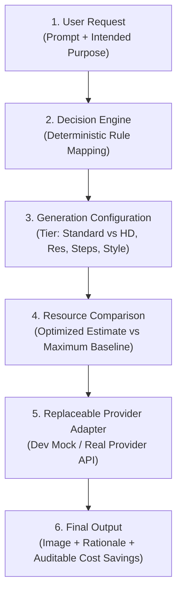

# Project Roadmap & Execution Plan (Notion Master)
**Project:** Resource-Aware Image Generation (Hack Fest — PS 1)  
**Repository:** [https://github.com/poovaragansiva-collab/Hackfest](https://github.com/poovaragansiva-collab/Hackfest)  
**Branch:** `feat/decision-engine`  
**Stack:** React (Vite) + FastAPI (Python 3.12) + Replaceable Provider Adapter  
**Last Updated:** Current Hackathon Session  

---

## 1. Problem Statement & Revealed Hints

### The District Scenario
A district education office provides an AI image-generation tool to create visual aids (worksheets, flashcards, posters) across **300 schools**. Within one month, its cloud bill tripled.

An audit revealed that the tool treated every request identically: simple black-and-white coloring outlines for primary school children were generated using the exact same expensive, high-resource settings (`dall-e-3-hd` large-format at $0.080–$0.120/image) as full-color annual report posters.

### Official Hints
1. **Hint 1:** *“The tool is not doing anything wrong. It simply never asks what the picture is for.”*
2. **Hint 2:** *“A colouring sheet for a seven-year-old does not need the same effort as a printed banner. Who decides how much effort a picture is worth, and does the person asking for it ever see the difference?”*

---

## 2. The 4 Official Requirements & Core Objectives

| # | Official Requirement | Project Implementation | Status |
|---|---|---|---|
| **R1** | **Ask the user what the image is intended for** | Compulsory `intended_use` input in frontend form & Pydantic schema (`coloring_worksheet`, `flashcard`, `classroom_handout`, `presentation_slide`, `annual_report_poster`, `hallway_banner`). | **Implemented (Backend)** |
| **R2** | **Match computational effort to the image's purpose** | Pure, deterministic `DecisionEngine` evaluates purpose and selects justifiable resolution, sampling steps, and quality tier. | **Implemented (Backend)** |
| **R3** | **Implement at least two working quality tiers** | `standard` (1024x1024, fast sampling, 50% lower cost) and `hd` (1024x1792, rich fidelity). Supported across Decision Engine and Dev Mock. | **Implemented (Backend)** |
| **R4** | **Show resource estimate & savings vs. maximum baseline** | `resource_metrics` block reports estimated cost, legacy baseline cost, calculated savings %, and transparent calculation basis. | **Implemented (Backend)** |

---

## 3. Central System Workflow



---

## 4. Current Status: Implemented vs. Planned

### Implemented Features (Verified & Tested)
- [x] **Validated API Contract (`POST /api/v1/generate`, `GET /health`)**
  - Validates prompts (min 3 chars), enumerated educational purposes, optional color constraints, and execution mode (`optimized` vs `baseline`).
- [x] **Deterministic Purpose-Aware Decision Engine (`decision_engine.py`)**
  - Maps low-fidelity needs (e.g. coloring sheet) to `standard` tier with prompt refinement (`clean bold line art, pure white background`).
  - Maps high-fidelity needs (posters, banners) to `hd` tier.
- [x] **Replaceable Provider Architecture (`base.py`, `mock_provider.py`)**
  - Base abstract class `BaseImageProvider` keeps provider adapters decoupled from decision rules.
  - Development mock provider returns responsive SVGs dynamically rendered and labeled with purpose, tier, and color constraints.
- [x] **Transparent Resource & Cost Accounting**
  - Grounded in published OpenAI DALL-E 3 pricing ($0.040 Standard vs $0.080 HD baseline).
  - No invented energy/kWh numbers; pricing source and calculation methodology are explicitly documented.
- [x] **Automated Test Suite (`backend/tests/`)**
  - 9 automated pytest tests passing (Health check, input validation edge cases, purpose mapping arithmetic, baseline vs. optimized comparison).

### Planned Features (In Progress & Next Steps)
- [ ] **React Frontend (Member 2)**
  - Interactive web UI with prompt text area, purpose selector dropdown, quality tier toggle, and visual comparison card.
  - Side-by-side view showing: (A) Baseline unoptimized request vs (B) Purpose-optimized request.
- [ ] **Real Provider Research & Adapter (Member 3)**
  - Confirm API key availability (e.g., OpenAI / Stability AI).
  - Implement concrete provider adapter adhering to `BaseImageProvider`.
- [ ] **District 300-School Simulation & Evidence Pack (Member 4)**
  - Scripted evaluation demonstrating the annual $2,280/year savings across 300 schools.
  - Visual fidelity inspection comparing coloring outlines vs full banners.

---

## 5. Team Assignments & Integration Dependencies

```text
Member 1 (Lead & Backend) ───► Provides API Contract & Mock ───► Member 2 (Frontend)
                                           │
                                           ├───► Provides Base Adapter ─────► Member 3 (Provider)
                                           │
                                           └───► Provides Baseline Mode ────► Member 4 (Testing/Eval)
```

### Member 1: Backend, Architecture, Integration & Lead (You)
- **Role:** Maintain FastAPI backend, Decision Engine, API contracts, provider interface, and end-to-end integration.
- **Immediate Task:** Support Member 2 with live dev server, verify provider adapter hooks, ensure demo readiness.

### Member 2: React Frontend
- **Role:** Build user-facing UI in `frontend/`.
- **Inputs/Dependencies:** Consumes `POST /api/v1/generate` and `GET /health` defined in `docs/api_contract.md`.
- **Deliverables:** Form with purpose dropdown, rationale card, resource estimate pill, side-by-side baseline comparison.

### Member 3: Image-Generation Provider Research
- **Role:** Confirm provider capabilities, parameters, and pricing tiers.
- **Inputs/Dependencies:** Uses `docs/provider_research_template.md` and implements `BaseImageProvider` in `backend/app/providers/`.
- **Deliverables:** Completed research document and optional production adapter (e.g., `openai_provider.py`).

### Member 4: Testing, Evaluation & Evidence
- **Role:** Quantify cost savings, verify district scale economics, and assemble demonstration evidence.
- **Inputs/Dependencies:** Uses `docs/evaluation_guide.md` and backend baseline comparison mode (`mode=baseline`).
- **Deliverables:** 300-schools cost simulation report and test verification checklist.

---

## 6. Milestones & 20+ Hour Timeline

| Milestone | Timeframe | Focus | Deliverables |
|---|---|---|---|
| **M1: Foundation & Contract** | Hours 0 – 3 | Architecture, Git setup, API contract | `.env.example`, Pydantic schemas, `api_contract.md`, Git feature branch |
| **M2: Decision Engine & Mock** | Hours 3 – 7 | Decision rules, tiers, mock generation | `decision_engine.py`, `mock_provider.py`, 9 passing unit tests |
| **M3: Frontend Prototype** | Hours 7 – 12 | React UI & backend integration | Prompt form, purpose selector, rationale display, live API connection |
| **M4: Real Provider & Baseline Comparison**| Hours 12 – 16 | Provider adapter & side-by-side mode | Optional real provider adapter, side-by-side baseline comparison UI |
| **M5: Evaluation & Evidence** | Hours 16 – 19 | District impact simulation | 300-schools evidence charts, edge-case testing, error handling |
| **M6: Final Polish & Demo Rehearsal** | Hours 19 – 20+ | End-to-end demo hardening | Flawless 3-minute live walkthrough script, freeze code |

---

## 7. Test Plan

1. **Automated Unit Tests (`pytest`)**:
   - `test_health.py`: Verifies service status and active provider reporting.
   - `test_validation.py`: Verifies rejected empty/short prompts and invalid purposes.
   - `test_decision_engine.py`: Verifies deterministic output, quality tier selection (`standard` for worksheets vs `hd` for posters), prompt refinement, and cost reduction arithmetic.
   - `test_generate_api.py`: Tests full HTTP request lifecycle in both `optimized` and `baseline` modes.
2. **End-to-End Integration Tests**:
   - Browser form submission with React frontend talking to FastAPI at `http://127.0.0.1:8000`.
   - Inspection of rendered SVGs for outline vs banner styling.
3. **Provider Fallback Tests**:
   - Verify graceful degradation if real provider credentials are absent.

---

## 8. Final Demo Checklist (Walkthrough Script)

- [ ] **Introduction (30s)**: State the 300-school district problem and the audit finding (coloring outlines billed identically to annual report banners).
- [ ] **Revealed Hints (30s)**: Explain that the legacy tool failed to ask what the picture was for, and that 7-year-old coloring sheets don't need banner compute.
- [ ] **The Central Workflow (45s)**: Submit a coloring worksheet prompt live. Show how the Decision Engine picks `standard` quality tier ($0.040) instead of `hd` ($0.080) and refines the prompt for pure line-art.
- [ ] **Resource Comparison Card (30s)**: Display the instant 50% cost savings calculation and explain the $190/mo ($2,280/year) district-wide savings.
- [ ] **Contrast with Poster Prompt (30s)**: Submit an annual report poster prompt live. Show how the engine legitimately approves `hd` tier when the purpose demands it.
- [ ] **Technical Honesty (15s)**: Point out that all pricing is grounded in verified documentation, with zero fabricated energy claims.
